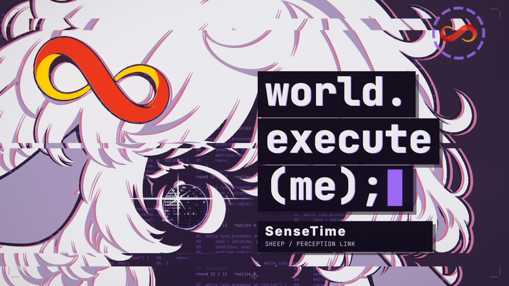

# SenseTime — world.execute(me);

商汤羊角色主题的版画歌词 MV，基于 Nyankomint 的第四版工程及 Amadeus 改编制作。当前工作分支为 `sensetime`，由 Amadeus 的 `05cd54a` 派生。



白色卷发、下垂羊耳、毛绒领袖、蝴蝶结和裙装沿用用户参考图。**所有七张最终角色素材均保留右上额发的红金无限符号发饰**，猫耳装扮也保留这一特征。F→M 镜头临时切换到短卷发、衬衫与背带短裤的男版，下一镜头恢复女版；后续镜头和封面使用原版女形象。源素材采用羊毛白 `#faf6ed`、灰褐 `#978276`、深棕 `#49362f` 三张墨版，渲染时映射为羊毛白、淡紫阴影与深紫轮廓；发饰以独立红金专色矢量版渲染。界面参考用户提供的小浣熊页面配色，采用白底、淡紫面板与紫色强调，错误与高潮段转为深紫。水果主体保留茄子紫与番茄红，果萼和茎使用紫色，并保留原版七瓣轮廓；几何与品牌圆环独立。日期回拉显示 `CURRENT RECORD` 与五组 `HISTORICAL RECORD` 图形卡（塔楼、尖塔、柱廊、阶梯神庙、金字塔）。编辑器名称统一为 **SenseTime**，启动、输入开关、观测记录、十二次连接尝试与关机采用感知及连接主题。

## 预览与检查

使用 Node.js 20+、Chrome 或 Edge，以及 ffmpeg。首次运行执行 `npm install`。

```sh
npm run preview
npm run check:sensetime
npm run storyboard -- --layout-only
npm run check:render
```

本机已同步 Amadeus 分支恢复的129行歌词和对应音轨，普通预览直接播放真实歌词与音频。缺少本地音源／歌词的新检出仍会自动进入带明确标记的占位模式；也可使用 `npm run preview:layout`。角色、标志、猫咪装扮及字段重组可分别用 `?lab=inks&layoutOnly=1`、`?lab=marks&layoutOnly=1`、`?lab=verse2&layoutOnly=1`、`?lab=pre2&layoutOnly=1` 查看。

原有 87 个镜头、129 行时间提示、歌词时间、节拍与五秒片头保留。当前启用 `video.exactRaster`，使 Canvas 文本栅格在跳转与顺序渲染时逐像素一致，WebGL 后期仍使用 GPU。检查脚本验证实际透明通道、红金发饰、关键区域、眼睛与掌心映射、品牌残留及镜头覆盖；渲染检查验证切点附近画面、跳转一致性和十二条连接路径。

## 封面与视频

```sh
npm run cover
npm run cover:portrait
npm run check:restored-lyrics
npm run check:render:lyrics
npm run export:final
npm run check:final
npm run export:layout
npm run check:layout
```

- 横版：`out/sensetime_cover.png`，1920×1080。
- 竖版：`out/sensetime_cover_portrait.png`，1080×1920，独立排版。
- 有声成片：`out/sensetime_1080p60.mp4`，真实歌词、1920×1080／60fps、H.264／AAC，保留一次五秒警告片头；CRF 16／fast 编码，三个连续帧区间渲染后无损拼接画面，再封装同步音轨。
- 可选无声占位导出（CRF 26／veryfast 编码）：`out/sensetime_layout_1080p60.mp4`，1920×1080／60fps、H.264／BT.709；保留五秒片头及占位标记，元数据包含 `mv_start=-5`、`layout_only=true`。此前本地文件保留为历史检查，当前交付使用上方有声成片。
- 关键帧与联系表、检查结果保存于本地 `out/`；封面副本保存于 `docs/images/`。

本地歌词及音轨来自 Amadeus `509caed` 工作树，文件逐字节一致；129行完整文字校验值与原时间表一致，镜头／节拍及起止时间保留。音轨是用户参考视频的 AAC 解码音轨，已移除参考片五秒片头，源 WAV 为 float32／44.1kHz 双声道。歌词、音轨及含歌曲视频由 `.gitignore` 排除。新检出按 [音源说明](音頻&歌詞/README.md) 放入本地文件后运行 `npm run lyrics`。4K 仅在显式运行 `npm run export:4k` 时导出。

视频检查依赖 Python 3 和 NumPy；使用 `MV_PYTHON` 指定已安装依赖的 Python 解释器。

`npm run check:layout` 检查最终 MP4 的编码、帧数、时间元数据和完整解码，并执行闪光与亮度量测、抽取12张成片关键帧。报告保存在 `out/sensetime_video_check.json`，包含最终文件的 SHA-256；检查失败时命令返回非零状态。

有声版使用 `npm run check:final`，同时量测音轨封装延迟，并从成片抽取全部129行歌词对应画面；报告保存到 `out/sensetime_final_video_check.json`。音画同步也可单独运行 `node tools/python.mjs tools/check_sync.py out/sensetime_1080p60.mp4`；有声版检查还需要 librosa 和 SciPy，依赖见 `tools/requirements-qa.txt`。

```sh
node tools/python.mjs tools/check_flash.py out/sensetime_layout_1080p60.mp4
node tools/python.mjs tools/luma.py out/sensetime_layout_1080p60.mp4
```

实际验证状态见 [SenseTime 制作记录](docs/SENSETIME.md)。闪光检查沿用原工程的近似量测工具，歌词与音源补齐后需复测。

## 来源与历史

界面标志使用填充飘带轮廓、开口卷曲端部和渐变阴影，完整与小尺寸 SVG 和 Canvas 共用路径。矢量来源及官网 PNG 对照记录在 [logo-sources.json](assets/sensetime/logo-sources.json)。

角色参考图和 AI 生成提示词保存在 [assets/sensetime/](assets/sensetime/)。当前文案为 `data/sensetime_chat.json` 与 `data/sensetime_errors.json`。详见 [来源记录](CREDITS.md) 和 [分镜表](STORYBOARD.md)。

Amadeus 的素材、文案及 [制作记录](docs/AMADEUS.md) 保留为历史；原作者的 Claude／Claude Code 制作过程保存在 `docs/v3/`、`docs/v4/`。历史验证结论只适用于相应版本。音乐和歌词属于 Mili 及相关权利人，不包含在仓库中；用户参考图与角色衍生素材不纳入代码 MIT 许可。

## English

A SenseTime sheep-character adaptation of Mili's *world.execute(me);*, based on Nyankomint's version 4 and the Amadeus adaptation. All seven final generated assets preserve the reference's red-and-gold infinity hairclip, including the temporary cat-ear costume. Wool white, taupe and dark brown form the main screenprint plates; the ornament is traced as separate vector spot ink. The editor is named SenseTime, with perception, observation and connection imagery. The rendered theme uses white and lavender panels with purple accents, then deep purple for the error and climax sections. The brand mark uses shared filled SVG/Canvas ribbon paths matched against the official logo, with a simplified version for small sizes.

The male sheep counterpart appears only during the F-to-M shot; the original female returns at the next shot and remains in all later scenes and covers. The 87-shot / 129-cue timeline, five-second preroll and deterministic renderer are retained. The local working copy now includes all 129 restored lyric lines and the reference video's decoded audio, synced from the Amadeus branch and excluded from Git. Run `npm run preview`, `npm run check:sensetime`, `npm run check:restored-lyrics`, and `npm run check:render:lyrics`. `npm run export:final` renders three frame-aligned ranges, joins their H.264 streams without re-encoding, and adds the audio once with the five-second delay. `npm run check:final` validates the delivered MP4. Layout exports remain available through `npm run export:layout`; new clones require local lyric and audio files. See [production and validation notes](docs/SENSETIME.md) and [credits](CREDITS.md).
