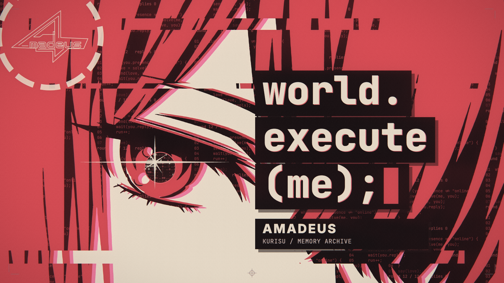

# Amadeus — world.execute(me);

牧濑红莉栖／Amadeus 红色版歌词 MV，基于 Nyankomint 的第四版工程改编。非官方同人作品，包含 AI 生成角色素材与 AI 辅助代码。



**[中文](#中文)** · **[English](#english)** · **[制作文件与提示词](docs/README.md)** · **[来源与授权](CREDITS.md)**

本改编位于 **[Amadeus 分支](https://github.com/EmiyaredA/world-execute-me-lyric-mv/tree/Amadeus)**；`main` 保留原始第四版。原作者的 Claude／Claude Code 制作记录保存在 `docs/v3/`、`docs/v4/`。

## 中文

### 当前版本

围绕“读取她的记忆—建立连接—反复尝试—保存并告别”展开。保留原曲时间轴、87 个镜头、129 行卡点、三色版画、代码图形和五秒片头警告。

角色改为牧濑红莉栖，沿用长发、白衬衫、红领带和落肩外套。主墨色为朱红 `#c64b52`、米白 `#f4e6d3` 和近黑 `#211819`；报错使用玫红，关闭状态使用灰阶。Amadeus 标志根据参考自绘为透明线稿，与十二段记忆环搭配；徽记保持直立，外环承担加载和思考动画。猫耳只作为短暂玩笑形态，F／M 段变化的是档案字段，人物始终是红莉栖。对方保持为匿名使用者。

| 段落 | 当前画面 |
| --- | --- |
| 启动 | 灰阶辉光管式数字、记忆校验、神经信号与逐渐对齐的角色墨版 |
| Vision | 关闭输入时变暗并加入低强度扫描线，人物、开关与文字保持清楚 |
| 日期回溯 | 当前红莉栖记忆之后，依次回溯城市、旧城、柱廊、神庙、金字塔的历史影像 |
| 十二次执行 | 十二条不同尝试路径最终都返回 `NO REPLY`，旧路径变暗留存 |
| 关机 | 信号停止，数字和记忆环逐位熄灭，保留 `ARCHIVE SAVED / CONNECTION CLOSED` |

全片马赛克已替换为变暗与扫描干扰，原有撕裂、墨版错位和高潮节奏保留。开头仅保留五秒独立警告页，歌曲开始后不再出现重复提示浮层。水果段使用自然配色：番茄红色、茄子紫色、叶蒂绿色，茄子切面为米白色。封面采用红莉栖眼部特写、三行代码标题和 Amadeus 线稿，由影片同一渲染管线生成。

**本机有声成片已完成歌词恢复。** 从用户提供的参考视频逐帧恢复全部 129 行，每行词语及完整文字的校验值均与原时间表一致；正式导出包含真实歌词和音乐，不显示占位预览标记。音乐来自参考视频的 AAC 音轨，并非原始无损音源。音轨、歌词、生成的 MP4、对照卡和压缩包均保留在本地，不随 Git 提交；重新克隆仓库仍需提供自己的音源和歌词。

### 运行

需要 Node.js 20+、Chrome 或 Edge。已在 macOS 的 Chrome／Metal 渲染管线验证。

```sh
git clone --branch Amadeus https://github.com/EmiyaredA/world-execute-me-lyric-mv.git
cd world-execute-me-lyric-mv
npm install
npm run preview
```

缺少歌词时，启动器会打开带占位文字的预览；也可显式运行 `npm run preview:layout`。拖动进度条检查全片，按空格播放无声预览。`?t=92.2&layoutOnly=1` 可跳到档案切换镜头。

本机补齐歌词后，普通 `npm run preview` 自动使用真实歌词和音频；`preview:layout` 仍明确选择旧的占位检查模式。

```sh
npm run cover
npm run cover:portrait
npm run check:amadeus
node tools/check_memory_lab.mjs
node tools/storyboard.mjs --layout-only
```

横版封面输出 `out/amadeus_cover.png`，尺寸为 1920×1080；README 使用的副本位于 [`docs/images/amadeus_cover.png`](docs/images/amadeus_cover.png)。`npm run cover:portrait` 输出重新排版的 1080×1920 [竖版封面](docs/images/amadeus_cover_portrait.png)，路径为 `out/amadeus_cover_portrait.png`。角色墨版可通过 `?lab=inks&layoutOnly=1` 查看；档案变化检查用 `?lab=pre2&layoutOnly=1`，标志检查用 `?lab=marks&layoutOnly=1`。

### 补齐音源与导出

将自己提供的原曲 WAV 与 LRC／纯文本歌词放在 [`音頻&歌詞/`](音頻&歌詞/README.md)，默认文件名见 `config.json → paths.audio / paths.lrc`。也可修改配置以匹配其他文件名。歌曲及填好的歌词不会提交到 Git。

```sh
npm run lyrics
npm run preview
npm run export:preview
```

补齐音源与歌词后，成片输出 **`out/amadeus_1080p60.mp4`**，1920×1080／60fps、H.264、AAC，包含原工程的 5 秒警告页。仅显式运行 `npm run export:4k` 时导出 4K。

LRC 的文字按原工程的 129 行重新分行，使用仓库内现有时间轴。音源开头留白不同时调整 `timing.offset`；若音源剪辑或速度不同，需重新分析并验收时间轴。

占位文本禁止用于普通成片导出。需要无声检查视频时，显式使用：

```sh
node export/export.mjs --layout-only --silent --width 1920 --height 1080 --fps 60 --cq 26 --out out/amadeus_layout_1080p60.mp4
```

当前改版关键帧与前后对比见 `out/amadeus_memory_keyframes.png`、`out/amadeus_memory_comparison.png`；完整尺寸单帧在 `out/sg_frames/`，最终视频抽帧检查见 `out/amadeus_memory_video_frames.png`。

### 从本地参考视频恢复歌词

macOS 可使用随工程提供的 Vision OCR 工具；需要 Swift 命令行工具和 FFmpeg。采样工具按现有时间表定位每行，匹配工具只在全部 129 行的词语与完整文字校验值均通过后写入本地歌词文件。弧线文字、拆分字母和数数转写需要补抽相邻帧并人工复核，记录在忽略目录的 `verified_text.json` 中。

```sh
mkdir -p out/lyric_recovery
swiftc tools/recognize_video_text.swift -o out/lyric_recovery/ocr
python3 tools/sample_video_lyrics.py /path/to/reference.mp4 --ocr out/lyric_recovery/ocr
node tools/match_video_lyrics.mjs
# 补齐人工核对记录、确认所有校验值匹配后：
node tools/match_video_lyrics.mjs --write
node tools/check_restored_lyrics.mjs
node tools/check_memory_lab.mjs --real-lyrics
```

本次交付的全部 129 行对照卡为 `out/amadeus_lyric_comparison.html`；逐行文字与原片证据记录为 `out/amadeus_lyric_recovery.json`；最终编码视频的逐行抽帧为 `out/final_lyrics_frames/`。这些材料只在本地交付。

此次参考视频含五秒片头，提取音轨时移除 220,500 个采样／声道，导出器再加入一次五秒警告。使用 float32 WAV 保留 AAC 解码音频，不归一化、不拉伸或额外截幅。其他参考视频应先校准片头长度，不能直接套用五秒。

### 验证

当前无声检查版为 1920×1080／60fps、H.264／BT.709，共 13,017 帧、216.95 秒，含五秒警告页且无音轨。330 个开关及切点附近帧检查通过；13 个时刻的跳转与顺序渲染哈希一致。一般闪光最高 2.0 次／秒，饱和红闪光为 0 次，无单帧突跳。详细结果与限制见 [改编与验证记录](docs/AMADEUS.md)。

真实歌词成片另检查了全部 129 行及 387 个相邻帧，并对最终 MP4 抽取 129 个歌词时刻及 434 个半秒采样帧：未检出占位符。正常音频预览通过，封装音轨偏移为 0 ms，闪光复测最高为一般 2.0 次／秒、饱和红 0 次／秒，无单帧突跳。原片时间表保持不变；声乐频段的自动起音统计和完整限制记录在改编说明中，不据此擅自移动歌词。

导出器新增可选 `--preset` 参数，默认配置保持原样。本次使用 `--preset fast`、原 CRF 16 画质目标进行软件 H.264 编码；源画面、帧率与时间轴不变。

`node tools/check_memory_lab.mjs` 使用实际 1080p 渲染检查切点和开关附近帧、跳转／顺序渲染一致性、十二条不同尝试路径和保留的镜头时间轴，并输出完整尺寸关键帧。需要本机 Chrome；在 macOS 使用 Metal。

`npm run check:amadeus` 检查角色 PNG 尺寸与 RGBA、关键区域、眼睛和手掌映射、87 个镜头及全部 129 行覆盖，线稿 SVG 与实时路径一致性，以及代码语法和旧品牌／男性素材残留。

视频检查需要 Python 3、NumPy、librosa（含其依赖）；可使用自己的 `.venv`，或用环境变量 `MV_PYTHON` 指定已有 Python 环境。

```sh
python3 -m venv .venv
.venv/bin/python -m pip install -r tools/requirements-qa.txt
npm run check
node tools/python.mjs tools/luma.py out/amadeus_1080p60.mp4
```

片中包含快速切换和强光，集中在成片时间 **<!-- flash-range -->2:33 – 3:17<!-- /flash-range -->**。保留原工程的警告页与光效限幅，最终带音源版本需重新检查一般闪光、红色闪光、单帧突跳、音频偏移和提示点。

### 素材与来源

- [`assets/amadeus/`](assets/amadeus/)：六张角色 PNG、角色／标志／封面参考、区域测量、内置 image_gen [生成提示词](assets/amadeus/prompts.json)，以及完整／简化线稿 SVG。
- `data/amadeus_chat.json`、`data/amadeus_errors.json`：当前主题文案。
- [改编记录](docs/AMADEUS.md)、[来源与授权](CREDITS.md)。
- [第四版原始 README](docs/v4/README_original.md) 和 `docs/v3/`、`docs/v4/` 保留原作者的 Claude／Claude Code 制作记录；其中原始导出和验收结论仅适用于第四版。

## English

An unofficial Amadeus / Makise Kurisu adaptation of Nyankomint's fourth-version lyric MV for Mili's *world.execute(me);*. The original timing, 87 shots, 129 lyric cues, five-second warning, and deterministic Canvas 2D + WebGL renderer are retained. AI-generated character assets and AI-assisted code are used. This adaptation lives on the **Amadeus** branch; `main` retains the original fourth version.

The palette is vermilion, cream, and near-black. A reference-derived Amadeus outline sits inside a twelve-segment memory ring. Boot, Vision, date rewind, twelve execution attempts, and shutdown use memory checks, neural traces, distinct historical image archives, and routes ending at the same `NO REPLY` node. Mosaic effects are replaced by dimming and scan interference. The five-second preroll warning is retained without a duplicate toast over the opening. Fruit bodies keep red tomato and purple eggplant inks, with green leaves and cream eggplant flesh. The cover pairs Kurisu's eye close-up with three lines of code-style title lettering.

### Run and export

Use Node.js 20+ and Chrome or Edge. Clone the `Amadeus` branch, run `npm install`, then `npm run preview`. Missing lyrics automatically select a labeled layout preview; `npm run preview:layout` selects it explicitly. `npm run cover` renders a 1920×1080 PNG; `npm run cover:portrait` renders a recomposed 1080×1920 [portrait cover](docs/images/amadeus_cover_portrait.png).

Supply your own audio and lyrics in [`音頻&歌詞/`](音頻&歌詞/README.md), following `config.json`. Run `npm run lyrics`, then `npm run export:preview` for `out/amadeus_1080p60.mp4` (1080p/60fps, H.264/AAC). The lyric file is fitted to the existing timing table. Adjust `timing.offset` if the audio has different leading silence; different edits or playback speeds need a new timing review.

The local completed video now contains **all 129 restored lyric lines and music**. Both word hashes and exact-text hashes match the original timing table. The supplied reference video's AAC audio was decoded to float32 WAV, with its existing five-second lead removed before the exporter adds the warning once. This is not a lossless original music source. Audio, lyrics, finished videos, comparisons, and reports stay local and are not committed; a fresh clone still needs your own audio and lyrics. The explicit `--layout-only --silent` command remains available for placeholder checks.

On macOS, the included Swift Vision sampler and hash matcher can recover text from a local reference. Unmatched paths, letter splits, and numeral transliterations require adjacent-frame review. `node tools/match_video_lyrics.mjs --write` refuses incomplete or nonmatching recovery; `node tools/check_restored_lyrics.mjs` checks the real data and normal audio preview. The local HTML comparison covers all 129 cues and uses frames extracted from the final encoded MP4.

### Validation and credits

`npm run check:amadeus` checks character geometry, branding, 87-shot/129-line coverage, and syntax. `node tools/check_memory_lab.mjs` checks actual rendered cue frames, seek consistency, and the twelve attempt routes. The current 1080p/60fps silent export has 13,017 frames over 216.95 seconds. Flash checks report at most 2.0 general flashes per second, no saturated-red flashes, and no single-frame pops; these are the existing project's approximate checks. Fast cuts and strong light occur at film time **<!-- flash-range -->2:33 – 3:17<!-- /flash-range -->**. Repeat the final checks after adding real lyrics and audio.

See [adaptation and validation notes](docs/AMADEUS.md), [production documents and prompts](docs/README.md), and [credits and licensing](CREDITS.md). The original author's Claude / Claude Code production records remain in `docs/v3/` and `docs/v4/`; their original export and validation claims apply to version 4. Character derivatives and references are outside the code's MIT license. Music and lyrics belong to their respective rights holders and are not included.
